<div align="center">


[](https://github.com/7etsuo)

</div>

---

```c
typedef struct {
    const char *name;
    const char *role;
    const char *org;
    const char *focus[5];
} developer_t;

static const developer_t tetsuo = {
    .name  = "7etsuo",
    .role  = "systems programmer & security researcher",
    .org   = "tetsuo.ai",
    .focus = {
        "networking stacks from scratch in C",
        "exploit development & ROP chains",
        "x86 and Solana BPF assembly",
        "decentralized AI infrastructure",
    }
};
```

---

<h2>Networking & Systems</h2>

<p align="left">
  <a href="https://github.com/7etsuo/tetsuo-pulse"></a>
  <a href="https://github.com/7etsuo/tcurl"></a>
  <a href="https://github.com/7etsuo/http-server"></a>
</p>

<h2>Security & Exploit Development</h2>

<p align="left">
  <a href="https://github.com/7etsuo/windows-api-function-cheatsheets"></a>
  <a href="https://github.com/7etsuo/win32-shellcode"></a>
  <a href="https://github.com/7etsuo/deepfreeze-exploit"></a>
</p>

<h2>Assembly</h2>

<p align="left">
  <a href="https://github.com/7etsuo/Learn-Solana-BPF-Assembly"></a>
  <a href="https://github.com/7etsuo/x86"></a>
  <a href="https://github.com/7etsuo/x86-assembler"></a>
</p>

<h2><a href="https://tetsuocorp.com">tetsuo.ai</a></h2>

<p>Decentralized AI agent infrastructure on Solana.</p>

<p align="left">
  <a href="https://github.com/tetsuo-ai/AgenC"></a>
  <a href="https://github.com/tetsuo-ai/DigitSuo"></a>
  <a href="https://github.com/tetsuo-ai/tetsuo-code"></a>
</p>

<details>
<summary><b>More projects</b></summary>
<br>

<p align="left">
  <a href="https://github.com/7etsuo/dragon-fight"></a>
  <a href="https://github.com/7etsuo/ROP-Lab-Server"></a>
  <a href="https://github.com/7etsuo/SecurePassGen"></a>
</p>

<p align="left">
  <a href="https://github.com/7etsuo/ytdl"></a>
  <a href="https://github.com/7etsuo/tetsuo-dox-agent"></a>
  <a href="https://github.com/tetsuo-ai/memsuo"></a>
</p>

<p align="left">
  <a href="https://github.com/tetsuo-ai/grok-api-mcp"></a>
  <a href="https://github.com/7etsuo/galaga"></a>
  <a href="https://github.com/7etsuo/tetsuo-gpu-miner"></a>
</p>

</details>

---

<p>
<b>Open Source</b>&ensp;
<a href="https://github.com/MicrosoftDocs/win32/pull/1551">Microsoft</a> ·
<a href="https://github.com/rust-lang/rust-by-example/pull/1694">Rust</a> ·
<a href="https://gitlab.com/kalilinux/documentation/kali-docs/-/merge_requests/281">Kali Linux</a> ·
<a href="https://www.kali.org/blog/kali-linux-2023-1-release/#community-shout-outs">Kali Blog</a> ·
<a href="https://github.com/ronin-rb/ronin-rb.github.io/pull/20">Ronin</a>
</p>

---

<div align="center">


<br>


<br>


</div>

<picture>
  <source media="(prefers-color-scheme: dark)" srcset="https://raw.githubusercontent.com/7etsuo/7etsuo/output/github-snake-dark.svg" />
  <source media="(prefers-color-scheme: light)" srcset="https://raw.githubusercontent.com/7etsuo/7etsuo/output/github-snake.svg" />
  
</picture>


